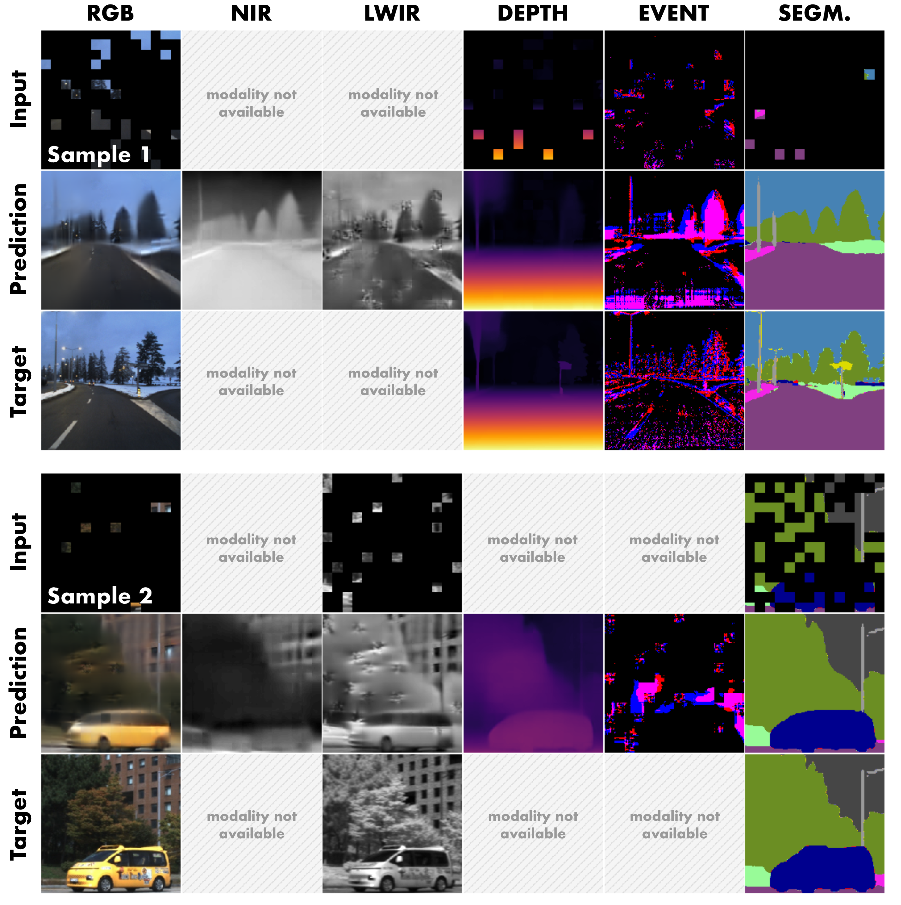
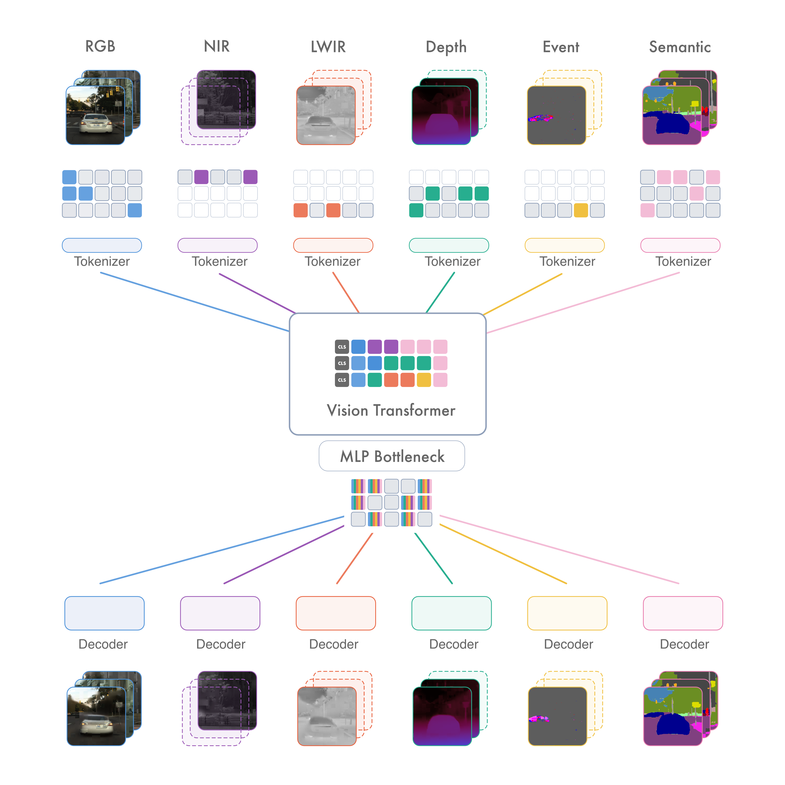

# Do Pretrained Backbones Transfer to Physical Sensors?

Official repository of the paper *"Do Pretrained Backbones Transfer to Physical Sensors? A
Systematic Study of Multimodal Initialization Across the Sensor Stack"*.

We pretrain **SensorMAE**, a multimodal masked autoencoder over the sensors found on
robots and vehicles (RGB, thermal LWIR/MWIR, reflective NIR/SWIR, event cameras, stereo
depth, plus semantic segmentation), and compare it with RGB-only and multimodal
initializations (ViT, MAE, DINO, MultiMAE) on downstream segmentation and detection with
RGB, thermal, NIR, event, depth, LiDAR and radar inputs.

<p align="center">
  
  
</p>


## Contents

| Folder | What it contains |
| :--- | :--- |
| [`preprocessing/`](preprocessing/) | Rebuilds the multi-sensor pretraining collection (16 public datasets, ~826k aligned samples) from the original releases, with the exact sample selection and splits of the paper. |
| [`benchmarking/`](benchmarking/) | Fine-tuning and evaluation on the downstream benchmarks: 256 experiment configs over Cityscapes, BDD100K, DSEC, FMB, MFNet, KITTI, LLVIP and SeeingThroughFog. |

Each folder has its own README, requirements and instructions.

## Pretrained weights

The SensorMAE encoders are released on the Hugging Face Hub:
[`dtu-pcas/sensormae`](https://huggingface.co/dtu-pcas/sensormae).

| File | Encoder | Parameters | Pretraining initialized from |
| :--- | :--- | ---: | :--- |
| `sensormae-base-mm` | ViT-B/16 | 101.7M | MultiMAE ViT-B |
| `sensormae-base-vit` | ViT-B/16 | 101.7M | ViT-B (ImageNet-21k) |
| `sensormae-small-vit` | ViT-S/16 | 29.6M | ViT-S (ImageNet-21k) |
| `sensormae-tiny-vit` | ViT-Ti/16 | 9.5M | ViT-Ti (ImageNet-21k) |

Every file holds the encoder only: one patch embedding, positional embedding and modality
embedding per pretraining modality (`rgb`, `lmwir`, `snir`, `depth`, `event`, `segm`), and
the shared transformer blocks. They are provided as `.pth` (read by the benchmarking code)
and `.safetensors` (same tensors).

Download them where the benchmarking configs expect them:

```bash
pip install -U huggingface_hub
hf download dtu-pcas/sensormae --include "*.pth" --local-dir benchmarking/weights
```

The MultiMAE baseline uses the official MultiMAE checkpoint:

```bash
wget -P benchmarking/weights https://github.com/EPFL-VILAB/MultiMAE/releases/download/pretrained-weights/multimae-b_98_rgb+-depth-semseg_1600e_multivit-afff3f8c.pth
```

The checkpoints contain tensors only and can be read with
`torch.load(path, weights_only=True)` or `safetensors.torch.load_file(path)`.

## Quick start

```bash
git clone https://github.com/DTU-PAS/sensormae && cd sensormae/benchmarking
python -m venv .env && source .env/bin/activate
pip install -r requirements.txt
cp machine_config.example.yaml machine_config.yaml
hf download dtu-pcas/sensormae --include "*.pth" --local-dir weights

# prepare a dataset under data/ (see benchmarking/README.md), then for example
python train.py --config configs/segmentation/mfnet/2_mfnet_rgb_lwir_sensormae_base_mm.yaml
python test.py  --config configs/segmentation/mfnet/2_mfnet_rgb_lwir_sensormae_base_mm.yaml
```

## License

The code and the SensorMAE weights are released under the [MIT License](LICENSE).
The datasets are not redistributed and keep their original licenses. Third-party code
adapted in `benchmarking/` (OpenPCDet, Detectron2) is listed in its
[README](benchmarking/README.md#license).
